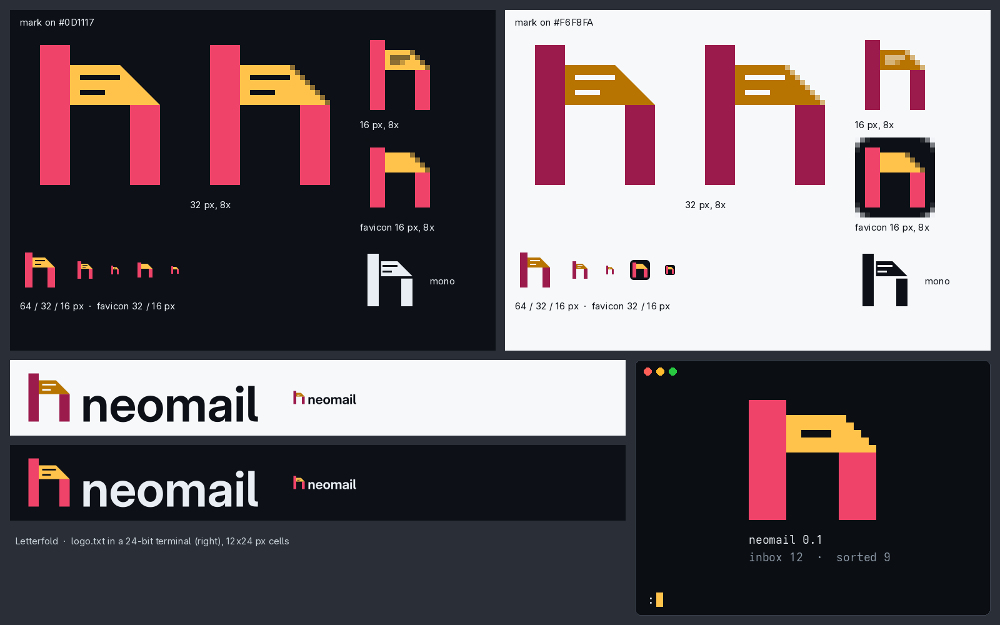

# 01 · Letterfold

**The idea.** A lowercase **n** folded from one strip of letter paper, in three panels like a letter folded in thirds: the stem stands in front, the middle panel shows the inside of the sheet with two lines of writing, and it folds down over the right leg along one 45-degree crease. It is the `n` of a monospace font, square spur and all, written on paper.



## What is Neovim about it

- It is the `n` as your terminal font draws it: upright, square, with the top-left spur that monospace `n` glyphs have. Every edge sits on a 4-unit grid, so the mark is pixel-exact at 16 px, the way a glyph is in a cell.
- Precise and economical: three flat panels, one diagonal. No prisms, no lean, no shading, no green or blue. Nothing is taken from the Neovim mark.
- It is built for the terminal: the half-block glyph is drawn by hand on the cell grid.

## What is mail about it

- The saffron panel is a sheet of paper with writing on it, folded like a letter. The crease is where a letter is folded to go into its envelope.
- The panel's end tucks behind the stem, the way an envelope's tuck flap does.
- It has no envelope rectangle, no V, no M and no bird, so it stays clear of Gmail, Outlook, Apple Mail, Proton Mail and Thunderbird.

## Files

| File | Use |
| --- | --- |
| `mark.svg` | Full-colour mark for light backgrounds |
| `mark-dark.svg` | Full-colour mark for dark backgrounds |
| `mark-mono.svg` | One colour (`currentColor`). The two seams open as 2.5-unit gaps and the writing is cut out |
| `favicon.svg` | Favicon and app icon: the same panels without the writing, on an ink tile |
| `lockup-light.svg`, `lockup-dark.svg` | Mark with the outlined `neomail` wordmark |
| `logo.txt` | Half-block glyph, 8 rows by 17 columns (`▀ ▄ █` and spaces only) |
| `logo.ans` | The same glyph in 24-bit ANSI colour (`cat logo.ans`) |
| `preview.png` | Review sheet |
| `build.py` | Regenerates everything above |

All SVGs are flat paths with a `viewBox`. They contain no `<text>`, raster images, filters or gradients. The full-colour mark is flat, so it needs no gradient fallback.

## Palette

| Role | Light backgrounds | Dark backgrounds | Contrast |
| --- | --- | --- | --- |
| Front of the sheet (stem, leg) | `#9C1B4D` mulberry | `#F0436A` raspberry | 7.37:1 on paper · 5.15:1 on ink |
| Inside of the sheet (panel) | `#B87400` deep saffron | `#FFC24B` saffron | 3.56:1 on paper · 11.78:1 on ink |
| Front against inside | | | 2.07:1 light · 2.29:1 dark |
| Wordmark | `#0D1117` ink | `#E8EEF3` off-white | |
| Backgrounds | `#F6F8FA` paper | `#0D1117` ink | |

The contrast figures are WCAG 2 relative-luminance ratios. They were computed with a one-off Python script using the WCAG 2.x formula; they are not in `build.py`. Each theme pairs a dark and a light tone, so front and inside differ in lightness as well as in hue.

## Construction

- 64-unit grid. Stem `x 8–20`, leg `x 44–56`, both 12 wide. The counter is 24 wide, twice a stem.
- The stem runs from `y 4` to `60`. The panel runs from `y 12` to `28`, so the stem's spur rises 8 units above it. The leg hangs from `y 28` to `60`.
- The crease runs from `(40, 12)` to `(56, 28)`. It is 45 degrees and as deep as the panel is tall.
- Writing: two cut-out rules, 2 units thick, at `y 16–18` (`x 24–40`) and `y 22–24` (`x 24–34`).
- Every outer edge is a multiple of 4, so it falls on a whole pixel at 16 px. The rules sit on multiples of 2, so they are whole pixels at 32 px.
- Wordmark: Adwaita Sans (SIL OFL), at `wght 640, opsz 32`, outlined through `../../src/text.py`. Its baseline sits on the foot of the mark.

## Small sizes

- **Master mark at 16 px.** The stems are 3 px, the counter 6 px, the spur 2 px and the panel 4 px, all on whole pixels. The n is crisp on both backgrounds. The writing turns into a grey smudge in the panel, so at 16 px the mark says "n" and nothing about mail.
- **`favicon.svg`** is the same geometry without the writing, on an ink tile so the dark palette holds on any background. The stem is 1 px shorter at each end to keep a 2 px margin in the tile. Use it for everything at 32 px or below.
- **32 px.** The rules are clean 1 px lines, and the sheet of writing starts to read.
- **Terminal.** `logo.txt` keeps the spur and the 45-degree crease, which steps one column per pixel row. Only one rule fits, as a gap in the panel. In `logo.ans` the panel is saffron and the stem and leg are raspberry.

```
█████
█████████████▄
███████▄▄▄▄████▄
█████▀▀▀▀▀▀▀█████
█████       █████
█████       █████
█████       █████
█████       █████
```

## Review notes

The art director's review of the first draft ("Prism Fold") said:

1. It read as a capital M.
2. It echoed Neovim's construction, with faceted prisms, a lean and two-tone legs.
3. It looked like a stool.
4. The saffron on paper was too weak.
5. The lean blurred the edges.

I agree with all five, so the mark is redrawn, not patched.

- **M:** removed. There is no V notch and no symmetry. The n is lowercase, with a spur on the stem only and the crease on the shoulder only.
- **Neovim:** removed. There is no lean and no prism shading. The stem and leg share one colour, and the only facet change is front against inside of the sheet. The name "Prism" is gone too. The folder keeps its name only because the brief fixes it.
- **Stool:** gone. The top is a flat panel with writing on it, not a slab in perspective.
- **Contrast:** the light-theme saffron is now `#B87400` (3.56:1 on paper), and the light-theme front is mulberry so the two tones still separate.
- **Lean:** removed. The edges are now pixel-exact at 16 px.

I disagree with one recommendation: dropping the direction. The direction's real idea is a letter folded into a letter, and that idea is sound. What failed was the V flap and the prism geometry, and both are gone. The raspberry and saffron palette also stays here instead of moving to another concept.

One thing for the owner to judge: the stem and leg use the same columns as the current cursor mark (`x 8–20` and `x 44–56`, `../../neomail-mark.svg`). The silhouettes differ: the cursor mark has a round arch and a teal leg, and this one has a square spur, a folded paper panel and a 45-degree crease. Both are still a geometric lowercase n.

## Rebuild

```sh
uv run --with pillow --with uharfbuzz --with fonttools python build.py
```

The build needs `rsvg-convert` for the preview and Adwaita Sans at `/usr/share/fonts/Adwaita/`.
