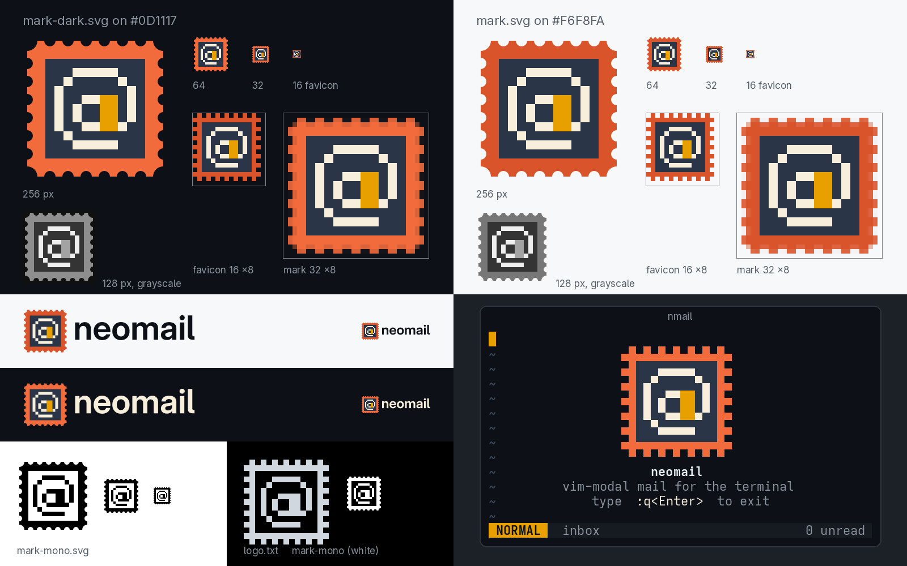

# 06 · Cell Stamp

A perforated postage stamp whose picture is a pixel-art **@**, with a **block cursor** as the right stem of its "a". Every pixel is half a terminal cell, so the picture in the SVG, the favicon and the half-block splash is the same 15 × 15 bitmap.



## Why it is Neovim

- The stem of the @ is a block cursor, 2 × 4 pixels, which is exactly 2 × 2 terminal cells. It is the Normal-mode cursor every Neovim user looks at all day, in the same amber as the `NORMAL` mode badge in the splash.
- In Vim, `@` is the key that plays a macro. A stamp that says `@` is mail that runs itself.
- The picture is made of the characters the TUI draws with (`▀ ▄ █`). Nothing is traced from the Neovim logo: no prisms, no N, and none of its green or blue.
- The splash in `preview.png` sits in an empty Neovim-style buffer: `~` lines, the cursor on line 1, `type :q<Enter> to exit`.

## Why it is mail

- Perforated edges are the most direct mail signal there is, and they need no envelope. That keeps the mark clear of the Gmail M-envelope, Proton Mail, Outlook, Thunderbird and Apple Mail.
- The @ is the address sign. The vermilion and cream are a nod to the Penny Red, the stamp that followed the Penny Black.

## Files

| File | Use |
| --- | --- |
| `mark.svg` | Full-colour master for light backgrounds, 32 px and up |
| `mark-dark.svg` | Full-colour master for dark backgrounds, 32 px and up |
| `mark-mono.svg` | One colour (`currentColor`). Stamp, @ and cursor are ink; the picture field is cut out |
| `favicon.svg` | Pixel-exact bitmap with square perforation, for 16 to 24 px (also crisp at 32) |
| `lockup-light.svg`, `lockup-dark.svg` | Mark and outlined `neomail` wordmark |
| `logo.txt` | Plain half-block stamp, 8 rows × 15 columns, only `▀ ▄ █` and spaces |
| `logo.ans` | 24-bit ANSI version (`cat logo.ans`) |
| `preview.png` | Review sheet |
| `build.py` | Regenerates everything above |

All SVGs are pure `<path>` elements with a `viewBox`. There is no `<text>`, no raster, no filter and no gradient. The art is flat, so a gradient would only blur it, and no flat fallback is needed.

## Palette

| Role | Hex | Contrast (WCAG) |
| --- | --- | --- |
| Stamp, dark theme | `#F26B3D` | 6.26:1 on `#0D1117` |
| Stamp, light theme and favicon | `#D9542B` | 3.75:1 on `#F6F8FA`, 4.73:1 on `#0D1117` |
| Picture field (screen) | `#2B3548` | 1.54:1 on `#0D1117`, 4.07:1 against `#F26B3D`, 3.08:1 against `#D9542B` |
| @ glyph and dark wordmark | `#F7EEDC` | 10.68:1 on the field, 16.42:1 on `#0D1117` |
| Cursor | `#E8A000` | 5.55:1 on the field, 1.93:1 against the cream |
| Light wordmark | `#0D1117` | 17.78:1 on `#F6F8FA` |

The ratios were computed with the WCAG relative-luminance formula in a short Python check during the build review; rerun it on these hex values to confirm. Vermilion sits about 10° of hue toward orange from Gmail's red (`#EA4335`). Keep it there, and never pair it with Gmail's blue, yellow and green.

## Construction

- One bitmap, `STAMP` in `build.py`, 15 × 15 pixels, with keys `p` paper, `k` picture field, `c` the @, `a` the cursor and `.` transparent.
- Stamp: one pixel of perforation, one pixel of paper margin, then an 11 × 11 field. The @ is 9 × 9 with a one-pixel margin: a 1 px ring open at the bottom right, a 3 × 4 bowl, and the cursor as the bowl's right stem. A one-pixel tail joins the foot of the cursor to the ring, as in a written @.
- The cursor occupies pixel rows 6 to 9, so in the terminal it is exactly two whole cells tall (`██` on two rows) with no half cells.
- Perforation, vector masters (`mark*.svg`, lockups): round bites centred on the paper edge, radius 0.62 px, at x = 2.5, 4.5 ... 12.5, with a 1.12 px quarter bite at each corner. The corner radius is 0.5 + the hole radius, so every tooth is the same width (0.76 px at the edge).
- Perforation, `favicon.svg` and the terminal: square one-pixel holes at the even columns, as the bitmap draws them.
- `mark*.svg` use `viewBox="-0.5 -0.5 16 16"`, which centres the 15 px art in a 16-unit square. Every pixel edge lands on a whole device pixel at 32, 64, 128, 256 and 512 px. `favicon.svg` uses `viewBox="0 0 16 16"` with the art flush top-left, so it is crisp at 16 px, at the cost of sitting half a pixel off-centre.
- Wordmark: the repo's **Adwaita Sans**, the same `wght 640, opsz 32` instance as the main logo, outlined through `../../src/text.py` (HarfBuzz + fontTools). The "l" is 8.6 px tall, the x-height is centred on the stamp, and the "n" starts 3 px right of the stamp.
- `logo.txt` pairs pixel rows into cells (`█ ▀ ▄`, space). `logo.ans` draws each cell as `▀` with the top pixel as foreground and the bottom pixel as background. Holes use the terminal's default background, so the perforation shows whatever is behind it. The name is not part of either file. The TUI prints `neomail` as ordinary text under the stamp, as in the splash mock.

## Small sizes, honestly

- **16 px (`favicon.svg`):** pixel-exact. At 1× it reads as an orange toothed stamp with a slate centre, a cream ring and an amber fleck. The @ is a 1 px line drawing and reads as an @ if you look for it; at a glance the perforation and the colour carry recognition, not the glyph.
- **16 px from `mark.svg`:** blurred by the half-pixel centring offset and the round bites. Do not serve it below 32 px; use `favicon.svg`.
- **32 px and up:** every pixel doubles cleanly. The @ and the cursor read clearly. The round perforation is slightly soft at 32 px and crisp from 64 px.
- **Grayscale and mono:** the cursor is a mid-grey against the near-white @ (1.93:1). In `mark-mono.svg` it merges into the @, which is fine because the @ is now complete without it.
- **Terminal:** `logo.txt` is the favicon bitmap, cell for cell. On a 1:2 terminal cell, each half-block is square.

## Review notes

| Art director's note | Response |
| --- | --- |
| The @ reads as "(U" | Agreed. The a now has a real bowl, and the cursor is only its right stem. The @ reads in mono and in grayscale (`preview.png`, bottom left). |
| `mark.svg` is a grey blur at 16 px | Agreed, documented rather than changed. Fifteen pixels cannot be centred on a 16 px grid, so `mark.svg` is for 32 px and up and `favicon.svg` is for 16 to 24 px. The preview shows the favicon in the 16 px slot. |
| Field `#171C26` collapses on `#0D1117` | Agreed. The field is now `#2B3548`, 1.54:1 on `#0D1117`. |
| Cursor fuses with the cream | Agreed. The cursor is now `#E8A000`, 1.93:1 against the cream. The sheet includes a grayscale proof. |
| `neomail` inside `logo.txt` | Agreed. Removed from `logo.txt` and `logo.ans`; the splash prints it as text. |
| Smooth vector master for 128 px and up | Partly agreed. The perforation is now true round bites in the masters. The picture stays on the cell grid: the brief for this direction is that the logo is literally made of terminal cells and looks the same as SVG and as half-block art. A smooth @ would make it a different logo above 128 px. The owner should pick another direction if pixel art is unwanted at large sizes. |
| Adwaita Mono wordmark | Agreed. The lockups now use the repo's Adwaita Sans (`wght 640, opsz 32`). A monospace wordmark stays an option for the owner, not a default. |

## Rebuild

```sh
cd assets/logo/variations/06-cell-stamp
uv run --with pillow --with uharfbuzz --with fonttools python build.py
```

This needs `rsvg-convert` and Adwaita Sans and Adwaita Mono under `/usr/share/fonts/Adwaita/`. Mono is used only for the terminal text in the preview. Intermediate renders go to `/tmp/neomail-logo-06/build`.
